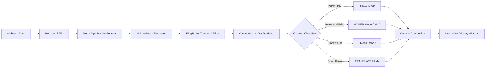

# 🎨 AirDraw: Real-Time Hand Gesture Virtual Canvas

<div align="center">

[](https://www.python.org/)
[](https://opencv.org/)
[](https://developers.google.com/mediapipe)
[](https://opensource.org/licenses/MPL-2.0)
[](https://github.com/sukrut07/Airdraw)

<p align="center">
  <b>A touchless, computer-vision-powered air canvas. Draw, hover, erase, and manipulate geometric primitives in real time using webcam hand-tracking and vector mathematics.</b>
</p>

</div>

---

## 📖 Overview

**AirDraw** transforms your standard computer webcam into an interactive gesture-controlled drawing canvas. By pairing **Google MediaPipe's** 21 3D hand landmark model with **OpenCV** and classical linear algebra, AirDraw accurately interprets hand gestures without requiring physical markers, styluses, or wearable hardware.

### 🌟 Core Highlights

- 🖐️ **Zero-Hardware Touchless Input**: Operates on any standard webcam at real-time frame rates.
- 📐 **Vector-Based Gesture Engine**: Classifies gestures via high-speed trigonometric angles and dot products instead of slow neural inference.
- 🖌️ **Multiple Geometric Primitives**: Freehand drawing, smooth circles, and axis-aligned squares.
- 🎨 **Floating Virtual HUD**: Interactive on-screen buttons for color picking and shape toggling.
- 🧼 **Spatial Collision Eraser**: Proximity-based collision detection wipes drawings within a customizable radius.
- ✋ **Interactive Translation**: Grab and drag drawn objects across the canvas using open-palm tracking.
- 🌌 **Dual Canvas Modes**: Instant toggle between real-time camera passthrough and a clean blackout blackboard.
- 📈 **Temporal RingBuffer Smoothing**: Multi-frame landmark averaging eliminates micro-jitter and delivers smooth strokes.

---

## 🖐️ Gesture & Control System

AirDraw uses hand landmark geometry to dynamically determine current interaction mode:

| Mode | Hand Pose | Trigger Condition | Functionality |
| :--- | :--- | :--- | :--- |
| **`DRAW`** | ☝️ **Index finger up** | Index extended, others curled | Draws the active primitive (freehand stroke, circle, or rectangle) |
| **`HOVER`** | ✌️ **Index + Middle fingers up** | Index and middle extended | Moves cursor passively across the HUD to select colors, shapes, or hit **Clear All** |
| **`ERASE`** | ✊ **Closed fist** | All fingers closed into palm | Erases any stroke, circle, or square intersecting the eraser contact zone |
| **`TRANSLATE`** | 🖐️ **Full open palm** | All 5 fingers extended | Calculates hand displacement and moves existing drawings across the screen |

### 🎛️ Keyboard Shortcuts

| Shortcut | Description |
| :--- | :--- |
| <kbd>b</kbd> | Toggle canvas background between **Live Camera Stream** and **Blackout Canvas** |
| <kbd>q</kbd> or <kbd>ESC</kbd> | Safely terminate the application loop and close OpenCV windows |

---

## 🧠 System Architecture & Pipeline



---

## 🚀 Getting Started

### 📋 Prerequisites

- **Python 3.8 to 3.11** *(Python 3.10 / 3.11 recommended for MediaPipe)*
- A functional webcam

### ⚡ Quick Start (Automated Launcher)

The repository includes a self-configuring shell script that detects the best Python version, sets up a virtual environment, checks dependencies, and launches AirDraw:

```bash
./run.sh
```

---

### 🛠️ Manual Installation & Execution

#### 🍎 macOS & 🐧 Linux

```bash
# 1. Clone the repository
git clone https://github.com/sukrut07/Airdraw.git
cd Airdraw

# 2. Create and activate a virtual environment
python3.11 -m venv venv
source venv/bin/activate

# 3. Install dependencies
pip install --upgrade pip
pip install -r requirements.txt

# 4. Launch AirDraw
python airdraw.py
```

#### 🪟 Windows (PowerShell / Command Prompt)

```powershell
# 1. Create and activate a virtual environment
python -m venv venv
.\venv\Scripts\activate

# 2. Install dependencies
pip install --upgrade pip
pip install -r requirements.txt

# 3. Launch AirDraw
python airdraw.py
```

---

## 📐 Mathematical Formulation

### 1. Angular Gesture Detection
Fingers are evaluated using the cosine of the angle $\theta$ between the palm-to-MCP vector $\vec{u}$ and the MCP-to-TIP vector $\vec{v}$:

$$\cos(\theta) = \frac{\vec{u} \cdot \vec{v}}{\|\vec{u}\| \|\vec{v}\|}$$

When $\cos(\theta) \ge \tau$ (where threshold $\tau \approx 0.70$), the finger is classified as extended; otherwise, it is recognized as folded.

### 2. Jitter Reduction with RingBuffer
To prevent frame-to-frame trembling, landmark coordinates are smoothed across a sliding temporal window of size $N=5$:

$$\bar{P}_i = \frac{1}{N} \sum_{k=1}^{N} P_{i,k}$$

where $P_{i,k}$ represents the 3D position of landmark $i$ at frame $k$.

---

## 📂 Repository Structure

```
Airdraw/
├── airdraw.py          # Main application loop, camera capture & event dispatcher
├── canvas.py           # Virtual canvas state manager, HUD buttons & rendering logic
├── hands.py            # MediaPipe wrapper, LandmarkBuffer & gesture recognition
├── util.py             # Geometric math, dot products, and vector operations
├── data.py             # Dataset capture and replay utility
├── run.sh              # One-command automated execution script
├── requirements.txt    # Project dependencies
├── HOW_TO_RUN.md       # Terminal guide for running on macOS, Linux, and Windows
├── LICENSE.md          # Mozilla Public License 2.0
└── README.md           # Project documentation
```

---

## 💡 Troubleshooting

- **Webcam permission denied (macOS)**: Ensure your terminal emulator has camera permissions under **System Settings > Privacy & Security > Camera**.
- **MediaPipe installation**: If using Python 3.12 or newer, use `python3.11 -m venv venv` to create the environment with official wheel support.
- **Lighting and Detection**: Ambient lighting improves hand landmark contrast and minimizes latency.

---

## 📄 License

Distributed under the [Mozilla Public License 2.0](LICENSE.md).
