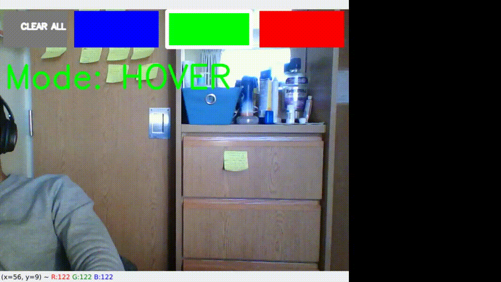
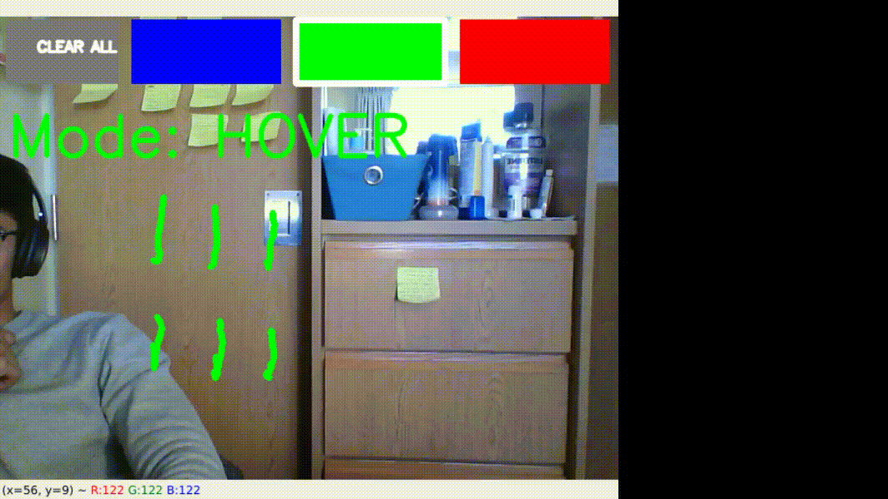
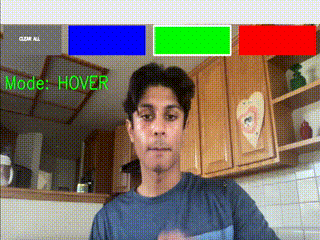
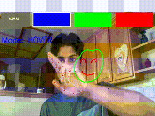

# 🎨 AirDraw: Gesture-Controlled Virtual Canvas

<div align="center">

[](https://www.python.org/)
[](https://opencv.org/)
[](https://developers.google.com/mediapipe)
[](https://opensource.org/licenses/MPL-2.0)
[](https://github.com/sukrut07/Airdraw)

<p align="center">
  <b>Draw, erase, hover, and manipulate shapes directly in the air using your webcam, computer vision, and real-time hand-tracking.</b>
</p>

</div>

---

## 📽️ Demo Showcase

Real-time air canvas interaction with zero physical markers or styluses needed:

<div align="center">
  
  <p><i>Full feature demonstration: Freehand Drawing, Hover Selection, Erasing, and Shape Translation.</i></p>
</div>

---

## ✨ Features

- 🖐️ **21 3D Hand Landmark Tracking**: Powered by Google MediaPipe for high-precision real-time hand skeletal tracking.
- 📐 **Vector-Based Gesture Classification**: Clean geometric angle and dot product heuristics to classify hand gestures without heavyweight neural models.
- 🖌️ **Multiple Primitives**: Switch seamlessly between **Freehand Lines**, **Circles**, and **Squares**.
- 🎨 **Dynamic Color Palette**: Select between vibrant colors (Blue, Green, Red, Yellow, Purple) on the floating interactive HUD.
- 🧽 **Proximity-Based Eraser**: Make a fist to wipe out strokes and shapes within your hand's radius.
- ✋ **Shape Translation**: Grab and drag existing drawings and shapes across the screen with an open hand gesture.
- 🌌 **Background Switcher**: Switch on the fly between live webcam passthrough and a minimalist solid black blackboard.
- 📈 **Jitter Reduction**: Ring-buffer smoothing to average landmarks across frames for clean, steady lines.

---

## 🖐️ Gesture & Control Guide

| Gesture | Visual Pose | Action Mode | Description |
| :--- | :--- | :--- | :--- |
| **Drawing** | ☝️ **Index finger up** | `DRAW` | Draws the active primitive (freehand stroke, circle, or rectangle) |
| **Hovering** | ✌️ **Index + Middle finger up** | `HOVER` | Cursor moves passively across HUD to select colors, shapes, or hit **Clear All** |
| **Erasing** | ✊ **Closed fist** | `ERASE` | Removes any stroke, circle, or square that intersects the eraser circle |
| **Translating**| 🖐️ **All 5 fingers extended** | `TRANSLATE` | Grabs existing drawings and moves them across the 2D plane |

### 🎛️ Keyboard Shortcuts

| Key | Function |
| :--- | :--- |
| <kbd>b</kbd> | Toggle canvas background between **Live Camera Stream** and **Blackout Canvas** |
| <kbd>q</kbd> or <kbd>ESC</kbd> | Safely exit AirDraw and close all windows |

---

## 📸 Gesture Visuals

| ✏️ Freehand Drawing | 👆 Passive Hover & Navigation |
| :---: | :---: |
|  |  |
| **🧼 Proximity Erasing** | **✋ Shape Translation** |
|  |  |

---

## 🚀 Getting Started

### 📋 Prerequisites

- **Python 3.8 – 3.11** (Python 3.10 or 3.11 is strongly recommended for MediaPipe compatibility on modern systems, including Apple Silicon).
- A working webcam.

### ⚙️ Quick Installation

1. **Clone the repository:**
   ```bash
   git clone https://github.com/sukrut07/Airdraw.git
   cd Airdraw
   ```

2. **Create and activate a virtual environment:**
   - **macOS / Linux:**
     ```bash
     python3.11 -m venv venv
     source venv/bin/activate
     ```
     *(If using default Python: `python3 -m venv venv && source venv/bin/activate`)*

   - **Windows (Command Prompt / PowerShell):**
     ```cmd
     python -m venv venv
     .\venv\Scripts\activate
     ```

3. **Install dependencies:**
   ```bash
   pip install --upgrade pip
   pip install -r requirements.txt
   ```

---

## 🎮 Running AirDraw

Launch the interactive air drawing application:

```bash
python airdraw.py
```

### 📹 Recording & Replaying Gestures

You can also record raw webcam sessions or replay captured sessions for testing:

- **Record a test video:**
  ```bash
  python data.py -m record -f sample.mp4
  ```
- **Replay a recorded video:**
  ```bash
  python data.py -m replay -f sample.mp4
  ```

---

## 📂 Project Architecture

```
Airdraw/
├── airdraw.py          # Main application loop, camera capture & event dispatcher
├── canvas.py           # Canvas state manager, shapes, HUD buttons & rendering logic
├── hands.py            # MediaPipe wrapper, LandmarkBuffer & gesture recognition
├── util.py             # Geometric algorithms, dot products, and vector mathematics
├── data.py             # Video collection and playback utility for debugging
├── requirements.txt    # Project dependencies
├── LICENSE.md          # Mozilla Public License 2.0
├── README.md           # Project documentation and guides
└── demo_gifs/          # Animated demonstration recordings
    ├── demo.gif
    ├── drawing.gif
    ├── hovering.gif
    ├── erasing.gif
    ├── translating.gif
    └── dotproduct.gif
```

---

## 💡 Troubleshooting

- **Webcam permission denied on macOS:** Ensure your terminal (Terminal, iTerm2, or VS Code) has camera access in **System Settings > Privacy & Security > Camera**.
- **MediaPipe installation error:** MediaPipe currently provides official wheels up to Python 3.11. If your default `python3` is 3.12 or 3.14, create the virtual environment using `python3.11 -m venv venv`.
- **Low FPS:** Ensure adequate room lighting for faster camera exposure times and optimal MediaPipe landmark inference.

---

## 📄 License

This project is licensed under the [Mozilla Public License 2.0](LICENSE.md).
