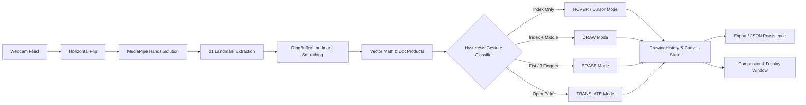
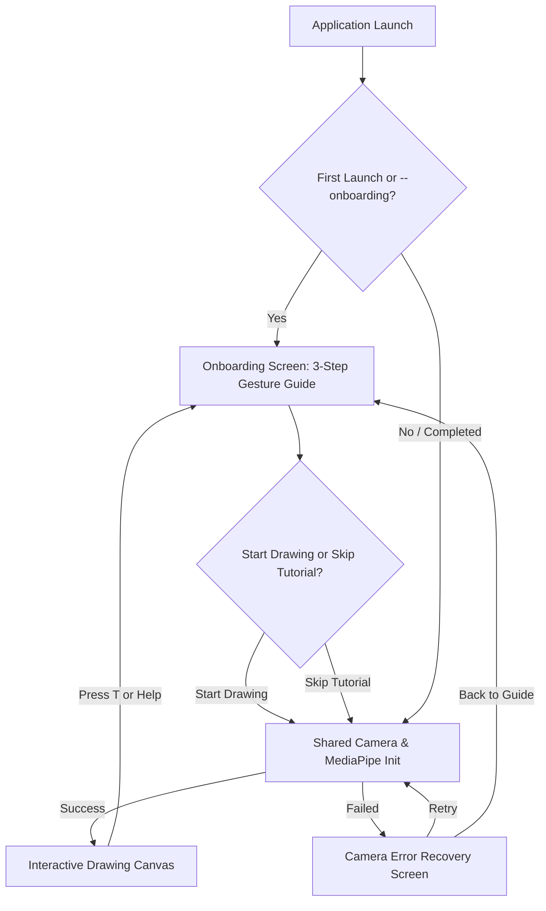

# AirDraw — Touchless Drawing with Hand Gestures

<div align="center">

[](https://www.python.org/)
[](https://opencv.org/)
[](https://developers.google.com/mediapipe)
[](https://opensource.org/licenses/MPL-2.0)
[](https://github.com/sukrut07/Airdraw)

<p align="center">
  <b>Turn your webcam into a drawing tool. AirDraw uses hand tracking to sketch strokes, create shapes, erase marks, and move artwork without touching your screen.</b>
</p>

</div>

---

## 📖 Overview

**AirDraw** turns a standard webcam into a touchless drawing canvas. It combines MediaPipe's 21 hand landmarks with OpenCV-based rendering and geometric gesture classification, so you can draw without a stylus or any additional hardware.

### 🌟 Core Highlights

- 🖐️ **Touchless Input**: Use a compatible webcam; performance depends on your camera and computer.
- 🎓 **Pre-Camera Gesture Onboarding**: Interactive tutorial screen appears before the camera starts. Teaches navigation, drawing, shape creation, erasing, translation, and shortcuts with procedural vector illustrations.
- 🚀 **Single Shared Init Path**: "Start Drawing" and "Skip Tutorial" share the exact same camera and hand-tracking initialization workflow.
- 📐 **Vector-Based Gesture Engine**: Classifies gestures via high-speed trigonometric dot products with 2-frame temporal hysteresis.
- ↩️ **Command-Pattern Undo/Redo**: Full drawing history engine supporting undo and redo across strokes, circles, squares, erasing, and canvas clears.
- 💾 **Save & Export**: Save editable projects as JSON and export clean or transparent PNGs at the canvas resolution.
- 🎨 **Compact Toolbar**: Pick from six colors and three drawing tools; the status bar shows the active gesture, tool, color, and brush size.
- 🛡️ **Safer Clear**: Hold the `CLEAR` control for 25 consecutive frames (~0.8s) to clear the canvas; the action can be undone.
- ℹ️ **Interactive In-App Guide & Tutorial**: Press <kbd>t</kbd> anytime to reopen the full Onboarding Tutorial, or press <kbd>h</kbd> for the quick on-screen HUD guide.
- 🧪 **Comprehensive CI & Tests**: 60 automated pytest unit tests covering vector math, canvas state, onboarding flow, collision detection, history, and persistence with GitHub Actions CI.

---

## 🖐️ Gesture & Control System

AirDraw uses hand landmark geometry to dynamically determine the current interaction mode:

| Mode | Hand Pose | Trigger Condition | Functionality |
| :--- | :--- | :--- | :--- |
| **`HOVER`** | ☝️ **Index finger up** | Index extended, others curled | Moves cursor passively; hover over the top toolbar to choose a color or drawing tool |
| **`DRAW`** | ✌️ **Index + Middle up** | Index and middle extended | Draws the active primitive (freehand stroke, circle, or rectangle) |
| **`ERASE`** | ✊ **Fist / 3 fingers** | Closed fist or 3 fingers | Erases any stroke, circle, or square intersecting the yellow eraser radius |
| **`TRANSLATE`** | 🖐️ **Open palm / horns** | All 5 fingers OR index + pinky extended | Calculates hand displacement and moves existing drawings across the screen |
| **`CLEAR`** | ⏱️ **Hold to confirm** | Index finger stays over `CLEAR` for 25 frames | Clears the canvas; Undo restores the artwork |

### 🎛️ Keyboard Shortcuts

| Shortcut | Description |
| :--- | :--- |
| <kbd>t</kbd> | Reopen full **Interactive Onboarding Tutorial & Gesture Guide** |
| <kbd>h</kbd> or <kbd>?</kbd> | Toggle **Quick Controls Guide Overlay** & gesture HUD |
| <kbd>b</kbd> | Toggle canvas background between **Live Camera Stream** and **Dark Whiteboard** |
| <kbd>z</kbd> or <kbd>Ctrl+Z</kbd> | **Undo** the last completed drawing, erasing, or clear action |
| <kbd>y</kbd> or <kbd>Ctrl+Y</kbd> | **Redo** the last undone action |
| <kbd>[</kbd> / <kbd>]</kbd> | Decrease / increase active brush thickness (1px to 30px) |
| <kbd>s</kbd> or <kbd>Ctrl+S</kbd> | **Save Project** (JSON) and **Export Clean PNG** (artwork only, no webcam feed) |
| <kbd>e</kbd> | **Export Transparent PNG** (alpha channel drawing export) |
| <kbd>q</kbd> or <kbd>ESC</kbd> | Close help card if open, or terminate the application loop cleanly |


---

## 🧠 System Architecture & Pipeline



---

## 🚀 Getting Started

### 📋 Prerequisites

- **Python 3.8 to 3.11** *(Python 3.10 / 3.11 recommended for MediaPipe)*
- A functional webcam

### ⚡ Quick Start (Automated Launcher)

The repository includes a self-configuring shell script that detects the best Python version, sets up a virtual environment, checks dependencies, and launches AirDraw:

```bash
./run.sh
```

---

### 🛠️ Manual Installation & Execution

#### 🍎 macOS & 🐧 Linux

```bash
# 1. Clone the repository
git clone https://github.com/sukrut07/Airdraw.git
cd Airdraw

# 2. Create and activate a virtual environment
python3.11 -m venv venv
source venv/bin/activate

# 3. Install dependencies
pip install --upgrade pip
pip install -r requirements.txt

# 4. Launch AirDraw
python airdraw.py
```

#### 🪟 Windows (PowerShell / Command Prompt)

```powershell
# 1. Create and activate a virtual environment
python -m venv venv
.\venv\Scripts\activate

# 2. Install dependencies
pip install --upgrade pip
pip install -r requirements.txt

# 3. Launch AirDraw
python airdraw.py
```

---

## 🎓 First-Launch Onboarding Experience

AirDraw features a built-in pre-camera onboarding screen rendered entirely in dark-mode OpenCV. It appears before opening the webcam or initializing MediaPipe, giving users an immediate overview of all touchless controls:



### Highlights:
- **Zero Premature Permissions**: The webcam is never accessed in the background during tutorial display.
- **Start Drawing**: Primary high-contrast button (<kbd>Enter</kbd> / <kbd>Space</kbd>) initializes camera and enters canvas.
- **Skip Tutorial**: Prominently visible at the bottom (<kbd>Tab</kbd> / <kbd>s</kbd>) to immediately bypass onboarding into drawing.
- **Single Shared Init Path**: Both buttons invoke the same robust initialization method, preventing resource leaks.
- **Reopen Guide Anytime**: Press <kbd>t</kbd> to pause drawing, release camera resources, and return to the onboarding screen. Press <kbd>h</kbd> for the in-app HUD card.
- **Camera Error Recovery**: If camera access fails (permission denied, device in use), an error screen offers **Retry Camera [R]**, **Back to Guide [B]**, and **Exit [Q]**.
- **CLI Options**:
  ```bash
  python airdraw.py --onboarding    # Force onboarding display
  python airdraw.py --no-onboarding # Direct launch into camera stream
  python airdraw.py --camera 1      # Use external camera at index 1
  ```

---

## 📐 Mathematical Formulation

### 1. Angular Gesture Detection
Fingers are evaluated using the cosine of the angle $\theta$ between the palm-to-MCP vector $\vec{u}$ and the MCP-to-TIP vector $\vec{v}$:

$$\cos(\theta) = \frac{\vec{u} \cdot \vec{v}}{\|\vec{u}\| \|\vec{v}\|}$$

When $\cos(\theta) > \tau$ (the implementation uses a default threshold of $\tau = 0.30$), the finger is classified as extended; otherwise, it is treated as folded.

### 2. Jitter Reduction with RingBuffer
To reduce frame-to-frame jitter, landmark coordinates are averaged across up to the five most recent tracked frames:

$$\bar{P}_i = \frac{1}{N} \sum_{k=1}^{N} P_{i,k}$$

where $P_{i,k}$ represents the 3D position of landmark $i$ at frame $k$.

---

## 📂 Repository Structure

```
Airdraw/
├── .github/workflows/  # CI pipeline (Python 3.10 & 3.11 test matrix)
├── demo_gifs/          # Optional recorded gesture and drawing demonstrations
├── airdraw.py          # Application loop, camera lifecycle & event dispatcher
├── onboarding.py       # Pre-camera onboarding screen, gesture cards & error dialog
├── canvas.py           # Canvas state manager, interactive HUD, shapes & renderer
├── hands.py            # MediaPipe wrapper, LandmarkBuffer & gesture classifier
├── history.py          # Command-pattern Undo/Redo drawing history engine
├── persistence.py      # JSON project serialization & clean PNG/transparent PNG exporter
├── util.py             # Geometric math, vector operations & Euclidean distance
├── tests/              # Automated unit test suite (60 pytest test cases)
├── data.py             # Dataset capture and replay utility
├── run.sh              # One-command automated launch script
├── requirements.txt    # Project dependencies & constraints
├── HOW_TO_RUN.md       # Step-by-step setup guide for macOS, Linux, and Windows
├── LICENSE.md          # Mozilla Public License 2.0
└── README.md           # Project documentation & reference
```

---

## 🧪 Automated Testing & CI

AirDraw includes a comprehensive unit test suite built with `pytest`:

```bash
# Run all tests
pytest -v

# Run tests with concise failure output
pytest --tb=short
```

Tests cover:
- **`tests/test_canvas.py`**: Shape geometry, coordinate boundary clamping, brush thickness, clear dwell confirmation, and help overlay.
- **`tests/test_gestures.py`**: Hand pose detection, temporal hysteresis transitions, and tracking-loss buffer resets.
- **`tests/test_history.py`**: Command pattern actions, single and multi-step undo/redo, branch invalidation, and clear reversals.
- **`tests/test_persistence.py`**: JSON project serialization, loading, and clean/transparent PNG export.
- **`tests/test_util.py`**: Vector Euclidean distance, dot products, vector normalization, and 2D bounds clamping.

---

## 💡 Troubleshooting

- **Webcam permission denied (macOS)**: Ensure your terminal emulator has camera permissions under **System Settings > Privacy & Security > Camera**.
- **MediaPipe installation**: If using Python 3.12 or newer, use `python3.11 -m venv venv` to create the environment with official wheel support.
- **Lighting and Detection**: Ambient lighting improves hand landmark contrast and minimizes latency.

---

## 📄 License

Distributed under the [Mozilla Public License 2.0](LICENSE.md).
