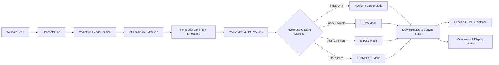

# 🎨 AirDraw: Real-Time Hand Gesture Virtual Canvas

<div align="center">

[](https://www.python.org/)
[](https://opencv.org/)
[](https://developers.google.com/mediapipe)
[](https://opensource.org/licenses/MPL-2.0)
[](https://github.com/sukrut07/Airdraw)

<p align="center">
  <b>A touchless, computer-vision-powered air canvas. Draw, hover, erase, and manipulate geometric primitives in real time using webcam hand-tracking and vector mathematics.</b>
</p>

</div>

---

## 📖 Overview

**AirDraw** transforms your standard computer webcam into an interactive gesture-controlled drawing canvas. By pairing **Google MediaPipe's** 21 3D hand landmark model with **OpenCV** and classical linear algebra, AirDraw accurately interprets hand gestures without requiring physical markers, styluses, or wearable hardware.

### 🌟 Core Highlights

- 🖐️ **Zero-Hardware Touchless Input**: Operates on any standard webcam at real-time 30+ FPS.
- 📐 **Vector-Based Gesture Engine**: Classifies gestures via high-speed trigonometric dot products with 2-frame temporal hysteresis.
- ↩️ **Command-Pattern Undo/Redo**: Full drawing history engine supporting undo and redo across strokes, circles, squares, erasing, and canvas clears.
- 💾 **Project Persistence & Export**: Save editable drawings to versioned JSON (`projects/`) and export high-res clean PNGs or transparent background PNGs (`exports/`).
- 🎨 **Floating Virtual HUD & Cursor**: Interactive multi-state cursor (`CURSOR`, `DRAW`, `ERASE`, `MOVE`) with 6 vibrant colors and a bottom telemetry status bar.
- 🛡️ **Accidental Clear Protection**: Hold-to-confirm dwell countdown (~0.8s hold with visual progress bar) prevents accidental canvas wipes; full wipe is reversible via Undo.
- ℹ️ **Interactive In-App Guide**: Press <kbd>h</kbd> or <kbd>?</kbd> at any time to display an on-screen gesture cheatsheet and keyboard reference card.
- 🧪 **Comprehensive CI & Tests**: 35 automated pytest unit tests covering vector math, canvas state, collision detection, history, and persistence with GitHub Actions CI.

---

## 🖐️ Gesture & Control System

AirDraw uses hand landmark geometry to dynamically determine the current interaction mode:

| Mode | Hand Pose | Trigger Condition | Functionality |
| :--- | :--- | :--- | :--- |
| **`HOVER`** | ☝️ **Index finger up** | Index extended, others curled | Moves cursor passively; hover over top buttons to pick color, shape, or trigger actions |
| **`DRAW`** | ✌️ **Index + Middle up** | Index and middle extended | Draws the active primitive (freehand stroke, circle, or rectangle) |
| **`ERASE`** | ✊ **Fist / 3 fingers** | Closed fist or 3 fingers | Erases any stroke, circle, or square intersecting the yellow eraser radius |
| **`TRANSLATE`**| 🖐️ **Open palm / horns** | All 5 fingers extended | Calculates hand displacement and moves existing drawings across the screen |
| **`CLEAR ALL`** | ⏱️ **Hold on button** | Index finger on *Clear all* | 25-frame dwell timer confirms wipe with a visual progress bar (undoable!) |

### 🎛️ Keyboard Shortcuts

| Shortcut | Description |
| :--- | :--- |
| <kbd>h</kbd> or <kbd>?</kbd> | Toggle **Interactive In-App Help Overlay** & gesture guide |
| <kbd>b</kbd> | Toggle canvas background between **Live Camera Stream** and **Dark Whiteboard** |
| <kbd>z</kbd> or <kbd>Ctrl+Z</kbd> | **Undo** the last completed drawing, erasing, or clear action |
| <kbd>y</kbd> or <kbd>Ctrl+Y</kbd> | **Redo** the last undone action |
| <kbd>[</kbd> / <kbd>]</kbd> | Decrease / increase active brush thickness (1px to 30px) |
| <kbd>s</kbd> or <kbd>Ctrl+S</kbd> | **Save Project** (JSON) and **Export Clean PNG** (artwork only, no webcam feed) |
| <kbd>e</kbd> | **Export Transparent PNG** (alpha channel drawing export) |
| <kbd>q</kbd> or <kbd>ESC</kbd> | Close help card if open, or terminate the application loop cleanly |

---

## 🧠 System Architecture & Pipeline



---

## 🚀 Getting Started

### 📋 Prerequisites

- **Python 3.8 to 3.11** *(Python 3.10 / 3.11 recommended for MediaPipe)*
- A functional webcam

### ⚡ Quick Start (Automated Launcher)

The repository includes a self-configuring shell script that detects the best Python version, sets up a virtual environment, checks dependencies, and launches AirDraw:

```bash
./run.sh
```

---

### 🛠️ Manual Installation & Execution

#### 🍎 macOS & 🐧 Linux

```bash
# 1. Clone the repository
git clone https://github.com/sukrut07/Airdraw.git
cd Airdraw

# 2. Create and activate a virtual environment
python3.11 -m venv venv
source venv/bin/activate

# 3. Install dependencies
pip install --upgrade pip
pip install -r requirements.txt

# 4. Launch AirDraw
python airdraw.py
```

#### 🪟 Windows (PowerShell / Command Prompt)

```powershell
# 1. Create and activate a virtual environment
python -m venv venv
.\venv\Scripts\activate

# 2. Install dependencies
pip install --upgrade pip
pip install -r requirements.txt

# 3. Launch AirDraw
python airdraw.py
```

---

## 📐 Mathematical Formulation

### 1. Angular Gesture Detection
Fingers are evaluated using the cosine of the angle $\theta$ between the palm-to-MCP vector $\vec{u}$ and the MCP-to-TIP vector $\vec{v}$:

$$\cos(\theta) = \frac{\vec{u} \cdot \vec{v}}{\|\vec{u}\| \|\vec{v}\|}$$

When $\cos(\theta) \ge \tau$ (where threshold $\tau \approx 0.70$), the finger is classified as extended; otherwise, it is recognized as folded.

### 2. Jitter Reduction with RingBuffer
To prevent frame-to-frame trembling, landmark coordinates are smoothed across a sliding temporal window of size $N=5$:

$$\bar{P}_i = \frac{1}{N} \sum_{k=1}^{N} P_{i,k}$$

where $P_{i,k}$ represents the 3D position of landmark $i$ at frame $k$.

---

## 📂 Repository Structure

```
Airdraw/
├── .github/workflows/  # CI pipeline (Python 3.10 & 3.11 test matrix)
├── airdraw.py          # Application loop, camera lifecycle & event dispatcher
├── canvas.py           # Canvas state manager, interactive HUD, shapes & renderer
├── hands.py            # MediaPipe wrapper, LandmarkBuffer & gesture classifier
├── history.py          # Command-pattern Undo/Redo drawing history engine
├── persistence.py      # JSON project serialization & clean PNG/transparent PNG exporter
├── util.py             # Geometric math, vector operations & Euclidean distance
├── tests/              # Automated unit test suite (35 pytest test cases)
├── data.py             # Dataset capture and replay utility
├── run.sh              # One-command automated launch script
├── requirements.txt    # Project dependencies & constraints
├── HOW_TO_RUN.md       # Step-by-step setup guide for macOS, Linux, and Windows
├── LICENSE.md          # Mozilla Public License 2.0
└── README.md           # Project documentation & reference
```

---

## 🧪 Automated Testing & CI

AirDraw includes a comprehensive unit test suite built with `pytest`:

```bash
# Run all tests
pytest -v

# Run with coverage report
pytest --tb=short
```

Tests cover:
- **`tests/test_canvas.py`**: Shape geometry, coordinate boundary clamping, brush thickness, clear dwell confirmation, and help overlay.
- **`tests/test_gestures.py`**: Hand pose detection, temporal hysteresis transitions, and tracking-loss buffer resets.
- **`tests/test_history.py`**: Command pattern actions, single and multi-step undo/redo, branch invalidation, and clear reversals.
- **`tests/test_persistence.py`**: JSON project serialization, loading, and clean/transparent PNG export.
- **`tests/test_util.py`**: Vector Euclidean distance, dot products, vector normalization, and 2D bounds clamping.

---

## 💡 Troubleshooting

- **Webcam permission denied (macOS)**: Ensure your terminal emulator has camera permissions under **System Settings > Privacy & Security > Camera**.
- **MediaPipe installation**: If using Python 3.12 or newer, use `python3.11 -m venv venv` to create the environment with official wheel support.
- **Lighting and Detection**: Ambient lighting improves hand landmark contrast and minimizes latency.

---

## 📄 License

Distributed under the [Mozilla Public License 2.0](LICENSE.md).
